# lzt_cad_grasp_ros 系统整体框架

可编辑 Mermaid 源文件：[lzt_cad_grasp_architecture.mmd](diagrams/lzt_cad_grasp_architecture.mmd)

## 文件使用说明

- 修改结构时只编辑 `.mmd` 源文件；
- SVG 用于 GitHub、Word、PPT 和 PDF；
- 修改源文件后重新生成 SVG，不要直接手工编辑 SVG；
- 紫色 GT 分支只用于离线训练、标定和评价，不进入在线机器人流程；
- 红色虚线模块为规划中的力/位混合柔顺放置，当前尚未实现。
